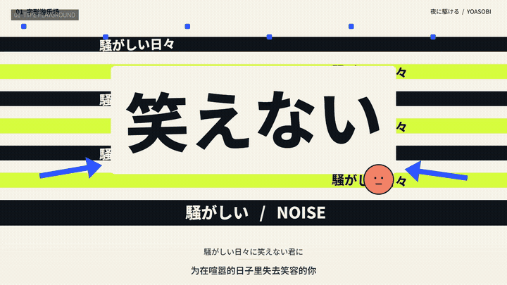

# Lyric Motion

**给编程 Agent 一首歌，在对话中生成歌词、制作和修改一支可编辑的 MV。**

[English](README.en.md) · [安装详情](docs/install.md) · [风格画廊](docs/styles.md) · [完整工作流](docs/workflows.md)

https://github.com/user-attachments/assets/84948bd4-842c-4238-83ac-2c314d4dc952

**同一首歌、同一段 22.33 秒，四种不同的画面语言。** 歌曲为 YOASOBI《夜に駆ける》，使用同一段日语演唱与歌词，底部配中文字幕。画面由代码绘制：字形碰撞、纸墨留白、空间材质、角色故事。

**点击上方播放按钮，观看 22 秒有声高光合辑。** [MP4 备用链接](docs/media/showcase/highlight.mp4) · [四风格同屏对比](docs/media/showcase/comparison.mp4)。下方画廊可分别观看每一版完整视频。

<details>
<summary>播放器无法加载？展开无声动图</summary>

[](docs/media/showcase/highlight.mp4)

</details>

## 一、为什么需要这个项目？

Codex、Claude Code 已经能通过代码绘制 MV。但从一句提示词到能交付的成片，还要处理歌词时间、音画同步、参考分析、字体加载、视频导出和修改检查。每次重建这套流程，很容易把精力耗在环境和细节上。

Lyric Motion 把这些流程整理成 **对话 Skill＋本地制作工具**，让 Agent 把精力放在当前歌曲的创作上：

- **从一首歌开始。** 已有歌词就直接使用；没有歌词，可以先识别并生成 LRC 草稿。字体、构图、分镜、技术和常规导出参数交给 Agent。
- **让内容参与动画。** 文字、图形、角色与镜头共同表达歌词，并配合音乐段落演出。
- **生成后还能改。** 每首歌独立保存输入、时间轴、可编辑代码、成片和检查记录，可以按时间点继续修改。

直接使用自己的 Codex／Claude Code 对话和模型权限。项目不另建生成网站、账号或模型服务；本地网页负责预览和播放。

## 二、快速安装

安装分两步：**从 GitHub 获取本项目 → 把 Skill 安装到你的创作目录**。`git clone` 负责获取源码；`node tools/cli.mjs install` 负责把 Skill 和制作工具装进指定目录，让 Codex／Claude Code 在这个目录中使用它。

### 方法 A：让 AI 帮你安装

在 Codex 或 Claude Code 中打开你准备用来制作 MV 的目录，把下面这段直接发给 AI：

```text
请帮我安装 Lyric Motion。
GitHub 仓库：https://github.com/hongmanjie/Lyric-Motion.git
安装位置：当前打开的项目目录。
客户端：你当前所在的 Codex 或 Claude Code。

请将仓库源码获取到独立目录，先阅读 README.md、AGENTS.md 和 docs/install.md，
按当前客户端完成项目级 Skill 安装。
检查 Node.js 22+、FFmpeg、FFprobe 和 Chrome／Edge／Chromium，
复用已有依赖，并说明需要补齐的依赖。
保留已有 Skill 和用户作品；遇到安装冲突时不要直接覆盖。
完成后验证安装结果，告诉我安装位置、如何启用，以及第一条创作指令。
```

### 方法 B：自己执行命令

**第 1 步：从 GitHub 获取源码。**

```sh
git clone https://github.com/hongmanjie/Lyric-Motion.git lyric-motion
cd lyric-motion
```

也可以在 GitHub 点击 **Code → Download ZIP**，解压后在源码目录打开终端。

**第 2 步：检查环境。** 需要 **Node.js 22+、FFmpeg／FFprobe、Chrome／Edge／Chromium**：

```sh
node tools/cli.mjs doctor
```

**第 3 步：安装 Skill。** 按客户端**二选一**。示例把创作目录命名为 `my-mv`，与源码目录 `lyric-motion` 并列；也可以把 `--target` 改成你的现有项目路径：

```sh
# Codex
node tools/cli.mjs install --agent codex --target ../my-mv

# Claude Code
node tools/cli.mjs install --agent claude-code --target ../my-mv
```

**第 4 步：打开创作目录。** 在对应客户端打开 `my-mv`，按下一节开始使用。Codex 的 Skill 位于 `.agents/skills/lyric-motion/`，Claude Code 的位于 `.claude/skills/lyric-motion/`。

安装时会复制所需工具，之后不依赖源码目录一直放在原位置。无需 `npm install`，工具本身不要求填写 API Key。[路径、更新和依赖说明](docs/install.md)。

只有音频、需要自动生成歌词时，再按需准备本地 Python／Whisper；首次使用会下载依赖和模型，之后复用缓存。已有 LRC 的创作不需要这一步。[歌曲识别为 LRC](docs/lyrics.md)。

## 三、快速使用

附上歌曲和 `.lrc`／`.srt` 歌词。在 Codex 中提及 `$lyric-motion`，在 Claude Code 中使用 `/lyric-motion`，然后直接说：

> 用这首歌和歌词做一支横屏 MV，俏皮、艺术一点，视觉重心清楚。美术、分镜和实现技术你决定。直接实现，检查实际画面和连续播放，修正明显问题，最后给我 MP4 和可编辑工程。

不用先选风格，不用填写分镜表或技术参数。也支持导入普通 `.txt` 歌词，但完成同步成片前需要可靠时间数据。找不到新安装的 Skill 时，重新开启对话，或让 Agent 直接读取安装目录中的 `SKILL.md`。[详细流程](docs/workflows.md)。

**只有歌曲，没有歌词？先说：**

> 只有这首歌，先识别歌词并生成 LRC，标出疑似错词，先不用制作 MV。

识别结果带实际模型估计的时间，不会把文本均分成时间轴。唱词识别可能出错，先核对草稿，再继续制作。

## 四、功能与启用方式

### 1. 生成歌词：歌曲 → LRC／SRT 草稿

上传歌曲，Agent 调用可选的本地 Whisper 识别，输出带时间的 `.lrc`、`.srt`、纯文本和原始转写数据，供后续 MV 使用。首次自动准备独立 Python 环境和模型，不需要转写 API Key。它是识别草稿，不是网上搜索来的歌词，也不承诺演唱逐字准确。

**在对话里说：**

> 只有这首歌，先用 Lyric Motion 识别歌词并生成 LRC、SRT 和文本，标出疑似错词。保留原音频和原始识别结果，先不用制作 MV。

[依赖、命令与校对方法](docs/lyrics.md)。已有官方歌词但没有时间时，请一并提供，便于核对；当前识别命令不把外部文本当作强制对齐输入。

### 2. 自由创作：歌曲＋歌词 → 原创 MV

Agent 根据新歌的歌词、情绪和音乐段落设计画面，可以使用字体、抽象图形、手绘场景等。默认是 `auto`，不会自动套用内置风格。

**在对话里说：**

> 用这首歌和歌词做 MV，不选内置方向，你自由发挥。画面切换跟随歌曲段落，快速但流畅，动作要和歌词含义有关系。

### 3. 选择风格：用四种内置方向制作 MV

内置的是可以修改的美术原则。具体镜头、时长、文字动作和构图仍为新歌重新设计，不把演示视频当固定模板。

| 1 · 字形游乐场 | 2 · 流动诗境 |
| --- | --- |
| [](docs/media/showcase/playground.mp4) | [](docs/media/showcase/poetry.mp4) |
| **让字形演戏。** 字词碰撞、弹跳、挤压与大胆尺度变化，画面重心随文字动作转移。[播放有声视频](docs/media/showcase/playground.mp4) | **让材料流动。** 墨液扩散、纸张折叠、负形光隙与朱砂线表达情绪，文字退到边缘。[播放有声视频](docs/media/showcase/poetry.mp4) |

| 3 · 数字雕塑 | 4 · 故事手绘 |
| --- | --- |
| [](docs/media/showcase/sculpture.mp4) | [](docs/media/showcase/storybook.mp4) |
| **让空间变形。** 立体结构、材质、光影与镜头运动组织视觉，随音乐压缩、分离、重组。[播放有声视频](docs/media/showcase/sculpture.mp4) | **让角色表演。** 连续人物、具体处境、动作和前后关系，把歌词演成手绘故事。[播放有声视频](docs/media/showcase/storybook.mp4) |

四版使用《夜に駆ける》的**同一段音轨、同一份歌词时间轴和中文字幕**，便于直接比较美术与动作的差异。点击封面播放对应有声 MP4。歌词时间采用有记录的行级估计，不把演示当作逐字精度证明。[风格资料与提示词](docs/styles.md)。

**在对话里说：**

> 用方向 4「故事手绘」做这首歌，主角是一只背着旧书包的小狐狸。让它的表情、动作和处境演出歌词，保持造型连续，随着音乐自然转场，底部歌词清楚。其他你决定。

也可以说“用方向 1，颜色暖一点，结尾安静一点”，或要求混合方向。用户明确要求优先。

指定主角能让故事更贴合你的想法；不指定时，Agent 会根据歌曲选择一组连贯角色，不必先补一张角色表。故事手绘强调角色表演、空间关系和因果，不只是给画面添加手写字体或纸纹。

### 4. 提炼风格：参考视频 → 可复用风格提示词

上传视频，可指定只看某个区域或时间段。Agent 观察字体、构图、动作、转场与歌词联动，产出可复用的风格提示词和结构化档案。可以只分析，也可以继续制作新歌。

**在对话里说：**

> 只拆解这个参考的上半部分，解释它的美术和动画如何呼应歌词。给我可迁移的风格提示词，不把新歌固化成参考的分镜，暂时不用制作成片。

[参考分析流程](docs/workflows.md#2-analyze-a-reference)。

### 5. 反推提示词：参考视频 → 完整制作请求

想做出与某条视频相似的效果时，反向整理它的构图、材质、动作机制、转场关系和段落推进，得到一份可以直接复制的完整制作请求。相比风格提炼，这条路径保留更多具体画面关系。Agent 会区分实际观察、推测和未确认内容，不能找回原作者的私密提示词。

**在对话里说：**

> 反推这个视频的制作提示词，目标是做出相似的构图、字体、材质、动作和转场。给我一份能直接复制使用的完整请求，标明观察与推测，先不用制作新视频。

交付 `reconstruction-prompt.md`、结构化分析和引用证据。[反推流程与产物](docs/reverse-prompt.md)。

### 6. 复用提示词：已有方向＋新歌 → 新 MV

参考提炼出的风格提示词、反推得到的制作提示词，以及自行填写的方向，都可以配合新歌曲和歌词使用。Agent 会按新内容调整文字、动作和时长。自带风格资料会替代内置方向，避免混入不相关指令。

**在对话里说：**

> 用这份提示词和我的新歌、歌词做 MV。保留其中的视觉与动作关系，但按新歌词重新设计内容和节奏。

### 7. 预览与修改：按时间点调整画面

本地预览支持播放和拖动时间轴，使用同一音频时钟。指出某一段的问题，Agent 即可保留上一版、修改工程、重新导出并检查受影响的段落。能否由 Agent 直接观看，取决于当前客户端实际具备的工具。

**在对话里说：**

> 8–12 秒画面太挤，让一个关键词成为视觉重心，用它的运动衔接下一幕。保留上一版，改完检查连续播放。

### 8. 字幕与导出：MP4、SRT 和可编辑工程

可以设计画面内的歌词层，交付 MP4、定时 SRT 和工程源码。默认横屏，也支持竖屏与方形。需要翻译时由 Agent 另行编写，歌词解析工具本身不翻译。

**在对话里说：**

> 最下面加一行中文歌词，大小适中，清楚但不抢画面。导出横屏 MP4、SRT 和可编辑工程，并保留原始歌词文件。

## 五、当前版本的实际边界

- LRC／SRT 保留用户提供的行级时间；可选 Whisper 会生成实际识别的时间估计，结果保持待核对。TXT 不会均分伪造同步；当前不提供外部歌词强制对齐、自动翻译或节拍检测。唱词准确度与逐字精度需另行核验。
- 工具负责素材准备与渲染，Agent 负责理解和创作。技术检查不能证明美术质量，也不能证明实际听过音频。
- 本机 Windows 工具链已经使用；两个客户端的新会话发现行为、macOS／Linux 主机还需更多实际验证。

## 六、工具、目录与参与贡献

普通用户可以一直用对话。歌词识别、导入、风格选择、参考准备、反推提示词、预览、导出等命令由 Agent 调用。[完整工作流](docs/workflows.md) · [架构](docs/architecture.md)。

```sh
node tools/cli.mjs styles
node tools/cli.mjs preview
node tools/cli.mjs render
node tools/cli.mjs help
```

新作品放在独立 `projects/` 目录，共享预览运行时位于 `src/`，每首歌的画面写在自己的 `artwork.js`。示例用于展示可能性。公开打包采用明确白名单；原始用户输入、参考视频和私人检查文件保留在独立作品目录，公开演示媒体单独管理。

媒体处理和渲染在本地完成；Agent 客户端决定哪些内容发给模型提供方。**本地工具不等于离线推理**。项目不复制模型凭证，不承诺订阅无限使用。

代码和项目原创内容采用 [MIT](LICENSE)，字体保留 OFL 声明。演示歌曲《夜に駆ける》、录音及歌词的权利归各自权利人，代码许可证不授予歌曲使用权。[第三方许可](THIRD_PARTY_NOTICES.md) · [演示素材来源](docs/media/README.md)。

[贡献说明](CONTRIBUTING.md) · [路线图](docs/roadmap.md) · [更新记录](CHANGELOG.md)。分享作品时说明提示词、模型／客户端、人工修改与素材许可。觉得有用，欢迎给一颗 Star，让更多人找到它。
