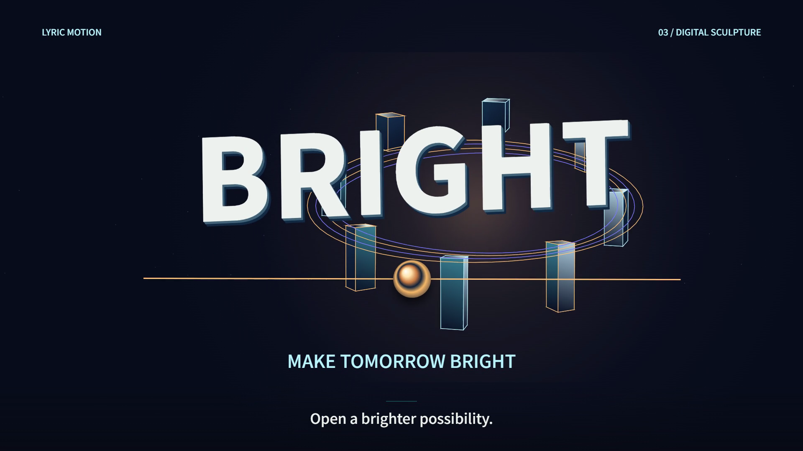
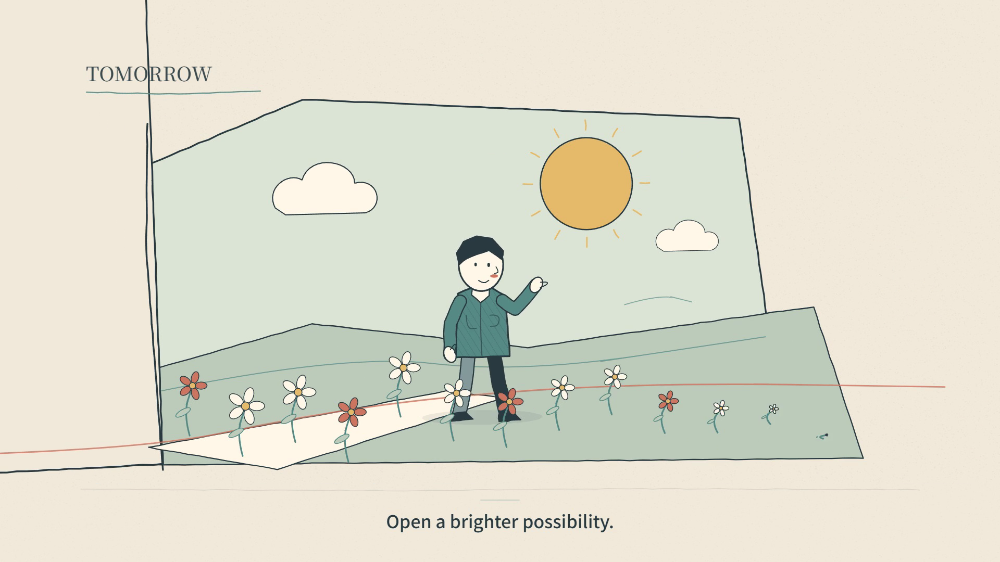

# Lyric Motion

**Give your coding agent a song and lyrics. Get a music video you can watch, revise, and edit as code.**

[中文](README.zh-CN.md) · [Installation](docs/install.md) · [Style gallery](docs/styles.md) · [Workflows](docs/workflows.md)

## 1. Why Lyric Motion?

Coding agents can draw an MV with Canvas, SVG, or WebGL. Making the result usable takes more than a long prompt: the audio must stay in sync, references need actual observation, fonts must load before rendering, and revisions must preserve the last good version.

Lyric Motion gives **Codex and Claude Code** a reusable creation workflow and local production tools:

- **Start with files and a sentence.** The agent handles ordinary typography, scene, implementation, and export decisions.
- **Make the song visible.** Words, shapes, characters, and scene changes can express lyric meaning and musical phrasing together.
- **Keep control after generation.** Each song has an independent, editable project with source media, timing, artwork, renders, and review notes.

Use your existing agent conversation and model access. There is no additional generation website, hosted account, or model backend. The browser page is a local preview and player.

## 2. Quick install

Getting the GitHub source and installing the Skill are two separate steps: **clone/download** gets this toolkit; **`install`** registers a self-contained Skill in the project where you will make your MVs.

### Option A — ask your agent to install

Open your intended creation folder in Codex or Claude Code and paste this request:

```text
Install Lyric Motion from https://github.com/hongmanjie/Lyric-Motion.git

Use the currently open project as the creation target and install for the current Codex or Claude Code client. Get the repository into a separate source folder, then read its README.md and AGENTS.md. Check Node.js 22+, FFmpeg/FFprobe, and Chrome/Edge/Chromium with the toolkit's doctor command. Install the project's local lyric-motion Skill into the creation target, preserving existing files and refusing to overwrite a conflicting Skill. Verify the installed toolkit, then report the installed path and the invocation I should use. Report missing prerequisites precisely.
```

### Option B — install manually

Prepare **Node.js 22+**, **FFmpeg / FFprobe**, and **Chrome, Edge, or Chromium**. Then:

1. **Get the source from GitHub.**

   ```sh
   git clone https://github.com/hongmanjie/Lyric-Motion.git lyric-motion
   cd lyric-motion
   ```

   Or choose **Code → Download ZIP** on that GitHub page, extract it, and open a terminal in the extracted folder.

2. **Check the local tools.**

   ```sh
   node tools/cli.mjs doctor
   ```

3. **Install the Skill into your creation folder.** Choose **one** client:

   ```sh
   # Codex
   node tools/cli.mjs install --agent codex --target ../my-mv

   # Claude Code
   node tools/cli.mjs install --agent claude-code --target ../my-mv
   ```

4. **Open `my-mv` in that client** and start creating with the request below.

The installation includes a self-contained toolkit and does not depend on the downloaded checkout staying in place. No `npm install` or API key is needed by the toolkit. [Paths, updates, and direct-checkout use](docs/install.md).

## 3. Make your first MV

Attach an audio file and `.lrc` or `.srt` lyrics. In Codex, mention `$lyric-motion`; in Claude Code, use `/lyric-motion`, then say:

> Make a landscape MV from this song and lyrics. Playful, artistic, with clear visual focus. You decide the scenes and technique. Implement it, watch continuous playback, fix visible problems, and deliver the MP4 and editable project.

No style choice, shot list, or technical form is required. Plain `.txt` lyrics can also be imported, but need real timing before a synchronized final export. If the Skill is not discovered, start a fresh conversation or explicitly ask the agent to read the installed `SKILL.md`. [Detailed workflow](docs/workflows.md).

## 4. Features — and how to use each one

### 1. Create a new MV freely from a song

The agent designs around the new lyrics and musical phrasing. It can use typography, abstract graphics, illustrated scenes, or another suitable direction. `auto` is the default; no built-in style is imposed.

**Say:**

> Use this song and lyrics to make an MV. Choose the art direction yourself. Keep the scene changes fluid and meaningful.

### 2. Create with one of four starting styles

Each direction is an editable set of creative principles. It does not install the example's scene order, timing, or finished artwork into your song.

| 1 · Type Playground | 2 · Flowing Poetry |
| --- | --- |
| [](docs/media/styles/playground/demo.gif) | [](docs/media/styles/poetry/demo.gif) |
| Bold letters, physical wordplay, playful scale. [MP4 with sound](docs/media/styles/playground/demo.mp4) | Paper, ink, flowing forms, expressive space. [MP4 with sound](docs/media/styles/poetry/demo.mp4) |

| 3 · Digital Sculpture | 4 · Story Sketch |
| --- | --- |
| [](docs/media/styles/sculpture/demo.gif) | [](docs/media/styles/storybook/demo.gif) |
| Dimensional forms, spatial movement, sculptural light. [MP4 with sound](docs/media/styles/sculpture/demo.mp4) | Drawn characters, changing places, and objects that perform the lyrics. [MP4 with sound](docs/media/styles/storybook/demo.mp4) |

Click an image for its animated preview. Public previews use original instrumental music and authored text; they do not demonstrate sung-vocal alignment. User-song studies and reference footage stay in private projects. [Profiles, prompts, and source](docs/styles.md).

**Say:**

> Use style 4, Story Sketch, for this song. Let characters and objects act out the lyrics, with quick, fluid changes that follow the phrasing. Keep the bottom lyrics easy to read.

Or: “Use style 1, with warmer colors and a quieter ending.” Styles can be adapted or mixed; your explicit request takes precedence.

### 3. Extract a reference's reusable style

Give the agent a video and optionally a region or time range. It observes the composition, typography, motion, transitions, and relationship to the lyrics, then saves a reusable style prompt and profile. This can be the entire task, or the starting point for a different song.

**Say:**

> Analyze the upper part of this video. Explain its visual language and how its animation relates to the lyrics. Give me a reusable style prompt without fixing the new song to the reference's shots. Do not make a new MV yet.

[Reference workflow](docs/workflows.md#2-analyze-a-reference).

### 4. Reverse-engineer a prompt for a similar video

Ask for a copyable request that could guide a **similar visible result**, retaining useful composition, motion mechanisms, scene relationships, and cadence. This is more specific than transferring a style. The agent separates observations from inferences and states what it actually viewed or heard. It cannot recover the original author's private prompt.

**Say:**

> Reverse-engineer a production prompt for this video. Describe the composition, materials, actions, transitions, and scene progression so I can make a similar video. Give me the complete copyable prompt, label uncertain details, and do not start a new production yet.

The deliverable is `reconstruction-prompt.md` plus structured analysis and cited evidence. [How it works](docs/reverse-prompt.md).

### 5. Apply a saved prompt to a new song

Supply an extracted style prompt, a reconstruction prompt, or your own written direction. The agent applies it to new lyrics and timing. A custom style bundle replaces the built-in direction rather than silently mixing unrelated instructions.

**Say:**

> Use this saved prompt with my new song and lyrics. Keep its visual relationships, but redesign the words, actions, and timing for this song.

### 6. Preview and revise a specific moment

The local preview shares the audio clock and supports scrubbing. Ask for a change at a specific moment; the agent edits the project, preserves the previous good version, renders, and reviews the affected interval. Actual video observation depends on the tools available in your client.

**Say:**

> At 8–12 seconds the screen feels crowded. Make one word the focus and connect the next scene through its movement. Preserve the previous version and check the revised playback.

### 7. Add captions and export the editable result

Create a composed lyric layer, an MP4, a timed SRT, and the editable project. The default format is landscape; portrait and square are also supported. Translation is agent-authored when requested, not generated by the lyric parser.

**Say:**

> Add subtle Chinese lyrics at the bottom, sized to stay readable without competing with the artwork. Deliver a landscape MP4, an SRT, and the editable project. Keep the original lyric file.

## 5. What to expect from this alpha

- LRC/SRT preserve supplied **line timing**. TXT remains unaligned; automatic forced alignment, transcription, translation, and beat detection are not bundled. Per-word accuracy needs real timing data.
- Local tools prepare evidence and render media; the agent does the interpretation and creative work. Technical checks do not prove visual quality or that audio was heard.
- Windows tooling has been exercised locally. Fresh-session client discovery and macOS/Linux host execution still need broader verification.

## 6. For contributors and direct tool use

Ordinary users can stay in conversation. The agent has commands for import, style selection, reference preparation, reverse-prompt preparation/export, preview, rendering, and subtitle export. [Command workflows](docs/workflows.md) · [Architecture](docs/architecture.md).

```sh
node tools/cli.mjs styles
node tools/cli.mjs preview
node tools/cli.mjs render
node tools/cli.mjs help
```

New songs live in independent `projects/` folders. The shared runtime is in `src/`; creation happens in each project's `artwork.js`. Example artwork demonstrates possibilities, not a compulsory template. Public release packaging uses an explicit allowlist and excludes private songs, references, and review files.

Media processing and rendering run locally; your agent client controls what is sent to its provider. **Local tooling does not mean offline inference.** The toolkit carries no model credentials and makes no promise of unlimited subscription usage.

Code, original demo text, and procedural score: [MIT](LICENSE). Bundled fonts retain OFL notices. [Third-party notices](THIRD_PARTY_NOTICES.md) · [Demo provenance](docs/media/README.md). Use media you are entitled to process and share.

[Contributing](CONTRIBUTING.md) · [Roadmap](docs/roadmap.md) · [Changelog](CHANGELOG.md). Share the prompts, client/model, manual edits, and asset permissions behind your examples. If Lyric Motion helps you make something worth sharing, a Star helps others find it.
