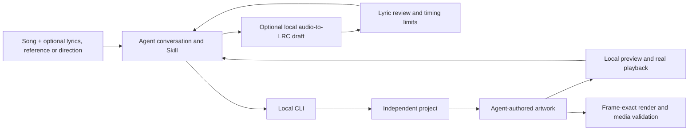

# Conversation-first architecture

This alpha runs through a user's existing Codex or Claude Code conversation. It has no hosted creation backend or generation website. The shared local preview is a viewer for artwork and exported videos. An optional local recognition module can generate a timed lyric draft before creation.



## Responsibilities

- The Skill teaches how to interpret a brief, inspect reference motion and meanings, design a new composition, inspect actual results, and refine them. It does not implement the model or promise native media capabilities.
- The local tools perform deterministic operations: import, probe, parse timed lyrics, prepare reference evidence, render, export captions and verify files.
- The optional recognition module runs Whisper models locally through faster-whisper. Its text and times are estimates, kept separate from reviewed lyric sources and deterministic rendering checks.
- The agent creates artwork for the current song, using the user's preferred implementation. Canvas is the included baseline, not an aesthetic requirement.
- `templates/artwork.js` is intentionally unfinished and blocks video export. A newly imported song never inherits the public demo's shot layout.

## Project layout

```text
my-song/
  request.json                 Portable user direction and relative asset paths
  state.json                   Prepared or needs_input / needs_alignment
  config/project.json          Actual duration, dimensions, fps and module paths
  assets/                      Original media and raw lyrics
  style/                       Imported prompt/profile, when provided
  timeline.json                Language-neutral text and timing
  artwork.js                   Agent-created, editable composition
  renders/                     Versioned MP4 and optional SRT
  qa/                          Technical report, stills and concrete review notes
```

`init` writes the prepared/needs_input state. It is not an autonomous agent-job scheduler; this alpha does not invent progress events. The agent records subsequent creation/review outcomes in the project. Keep original inputs and previous good renders.

## Timing

Audio duration is probed with FFprobe. The video duration is rounded down by less than one 30fps frame; no fixed 60-second assumption remains. LRC/SRT preserve their line timing. Blank LRC timestamp rows can terminate a phrase for an instrumental gap. TXT is kept unaligned with null times, and rendering is blocked until usable timing is supplied.

The timeline uses `text`, `start`, `end` and optional `tokens`. No token times are generated by dividing a sentence. Overlapping lines are preserved; the artwork decides how to show concurrent voices. The legacy `jp`/`morae` format has a compatibility reader and is not required for new languages.

## Optional audio-to-LRC module

`lyrics --audio FILE --out NEW_DIR` uses `lib/transcription.mjs` to probe the source, prepare the optional backend, invoke `tools/transcribe-lyrics.py`, and write an independent draft. `lyrics-setup` can prepare the environment separately. The core Node.js MV workflow remains dependency-free; the optional recognizer requires Python 3.10–3.13, FFmpeg/FFprobe, and faster-whisper 1.2.1 from `tools/lyrics-requirements.txt`.

First use installs into an isolated, ownership-marked virtual environment and downloads the requested model. Subsequent runs reuse the environment and model cache; `--python` and `--cache` control their locations. Recognition runs on local CPU without a transcription API key. Package/model downloads require network access; models and installed Python dependencies are not shipped in every Skill copy or public release.

The output contains `lyrics.lrc`, `lyrics.srt`, `lyrics.txt`, `transcription.json`, and `state.json` marked `draft-needs-review`. Raw model `sourceSegments` are retained. Readable `segments` may be regrouped only at actual model word boundaries; absent word times are not invented. `reviewHints` identifies some confidence-based concerns, not verified errors or an accuracy score. The source audio is not changed, and output refuses an existing directory.

This path is speech recognition on singing, not forced alignment of a supplied lyric sheet. It can omit, mishear, repeat, or hallucinate words. Preserve draft provenance and record any text/timing edits and actual listening coverage when using it for an MV. Confidence, metadata, and technical checks do not establish accurate sung alignment. See [the user workflow](lyrics.md).

## Artwork contract

```js
export const readyToRender = true; // only after original artwork exists
export const cuts = [0, 4, 8];     // optional scene boundaries, not a preset
export async function createArtwork({canvas, ctx, project, timeline}) {
  // Await fonts and other assets here.
  return {render(t) { /* t is seconds relative to this project */ }};
}
```

The shared page exposes `__ready`, `__meta`, `__seek(t)`, `__freeze()`. The exporter waits for readiness, uses precise frame times and checks arbitrary-seek reproducibility. Each frame starts from a reset canvas context. Stateful simulations must be derived reproducibly from time or baked; elapsed browser time must not change exported frames.

Projects serve their artwork and local assets at root-relative paths. The shared viewer lives at `/__runtime/`. Other frameworks need an equivalent deterministic integration/export and a documented command.

## Reference analysis and style reuse

`reference` prepares a selected range/region, at most 24 timestamped frames, and an H.264 yuv420p preview. It does not perform semantic analysis. The agent observes the actual result and writes findings/profile/prompt. Observed claims require timestamped evidence; inferences and unavailable audio inspection remain distinct.

`style-prompt` exports portable statements from a profile. `init --style-profile` and `init --style-prompt` copy prior style materials into a new project; the agent uses them alongside the new song and the user's current direction. No shot time or old song text is automatically transferred.

`styles` lists `auto` and four optional authored directions, including `storybook` / `4` / `故事手绘`. `init --style` resolves a number, English ID or Chinese name and copies only its profile/prompt. `auto` loads no style bundle. Explicit custom profile/prompt inputs replace the built-in bundle as a unit; `request.extensions.style` records what was selected and actually applied. The example artwork stays an example, so choosing a direction never marks new artwork complete.

## Video-to-prompt reconstruction

`reverse-prompt --video` prepares a reference study with timestamped evidence and an explicit `needs-analysis` draft. The agent observes and authors the reconstruction analysis. `reconstruction-check` validates its structure, time ranges, and declared coverage; `reverse-prompt --analysis` exports a copyable production request and independent cited evidence. The command does not infer visuals by itself or recover the original private prompt.

This is separate from transferable style extraction: reconstruction can preserve sequence, motion mechanisms, and scene relationships for a similar result. Either resulting prompt can guide new-song creation through `init --style-prompt`; words and timing must adapt to the new content. Observed motion requires declared continuous coverage, and unavailable listening remains an explicit limit. See [the workflow](reverse-prompt.md).

The JSON Schemas describe structural contracts. CLI `style-check` performs the documented basic workflow checks, not a complete JSON Schema validator. Neither form of validation proves the artistic truth of a profile.

## Installation and release

One canonical Skill source is copied into the client's project skill directory with a self-contained `toolkit/`. Paths derive from the installed location. Existing modified installations are preserved. Global installation and credential forwarding are outside this alpha.

`package` builds an explicit public allowlist into an English-named folder and tar archive, with SHA256 per file. It excludes user projects, private references, generated QA and intermediate renders. README media intentionally includes the original four-style highlight and a separate documented CC0 vocal example; their editable public sources are included. Release packaging is not a GitHub publish action.

## Host status

Local Windows tool execution, two installed toolkit copies, real FFmpeg imports/exports, local HTTP preview behavior and browser capture are exercised. Actual new-session discovery inside both independent client applications, and macOS/Linux host execution, remain to be verified. No claim of hosted/cloud agent compatibility is made.
