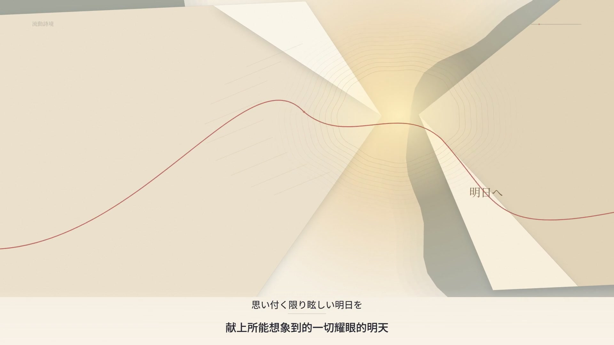
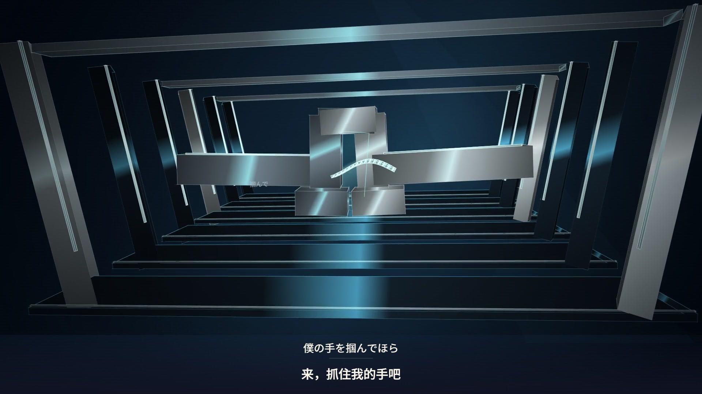
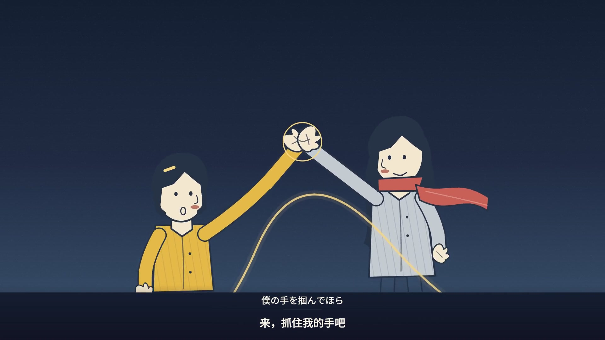

# 四个可选方向，默认仍然自由创作

可以只提供歌曲和歌词，让 AI 决定整条作品。想更快表达喜好时，再选一个方向；不需要填写技术提示词、分镜数量或字体参数。

| 选择 | 名称 | 偏向 |
| --- | --- | --- |
| `0` / `auto` | AI 自由创作 | 不加载预设，按歌曲重新设计。 |
| `1` / `playground` / `字形游乐场` | 字形游乐场 | 字形演戏、尺度反差、俏皮的物理关系。 |
| `2` / `poetry` / `流动诗境` | 流动诗境 | 纸墨、流体、负形光隙与留白承担叙事，文字只是注释。 |
| `3` / `sculpture` / `数字雕塑` | 数字雕塑 | 立体结构、空间材质、光影与镜头运动，形体承担视觉主体。 |
| `4` / `storybook` / `故事手绘` | 故事手绘 | 让手绘角色、物件与场景演出歌词里的故事。 |

这些是可修改的创作起点。它们不固定镜头数量、时长、排版或每一句歌词的处理。用户的明确方向、参考分析和自带风格提示词仍然优先。

四个方向都可以动感地演出：变化来自景别、尺度、角色动作、空间和转场之间的衔接，而不只是在字幕出现时闪一下。速度按歌曲、歌词和用户要求重新设计；纸张、墨线等安静材质也可以承载快速而清楚的变化。关键内容仍需要足够阅读时间。

## 看效果

下面四版使用维护者提供的 **YOASOBI《夜に駆ける》同一段 22.333 秒音轨、同一份歌词时间轴和中文字幕**，可以直接比较美术、动作和叙事的区别。日语演唱保留在有声 MP4 中。先看[四风格高光合辑](media/showcase/highlight.mp4)，或[四版完整对比](media/showcase/comparison.mp4)。

公开展示的是渲染片段、封面、GIF 与 manifest；全文歌词、原始音频输入和私人制作工程不公开。歌曲及录音不属于项目 MIT 授权。[素材来源与时间方法](media/README.md)。

### 1 · 字形游乐场

[](media/showcase/playground.mp4)

[播放有声视频](media/showcase/playground.mp4) · [可编辑风格](../examples/styles/playground/profile.json) · [提示词](../examples/styles/playground/prompt.md)

**字形是演员。** 字词碰撞、弹跳、挤压、拆分和重组，用尺度与速度表达压力、靠近和释放。字体动作组织视觉重心；构图按当前歌词重新设计。

### 2 · 流动诗境

[](media/showcase/poetry.mp4)

[播放有声视频](media/showcase/poetry.mp4) · [可编辑风格](../examples/styles/poetry/profile.json) · [提示词](../examples/styles/poetry/prompt.md)

**纸墨与留白是主体。** 墨液扩散、负形光隙、折叠空间和朱砂线串起情绪，少量文字沿纸边或墨线出现。让材料的挤压、分离、相接和溶化表达歌词，不把画面做成另一组大字标题卡。

### 3 · 数字雕塑

[](media/showcase/sculpture.mp4)

[播放有声视频](media/showcase/sculpture.mp4) · [可编辑风格](../examples/styles/sculpture/profile.json) · [提示词](../examples/styles/sculpture/prompt.md)

**空间与材质是主体。** 通过形体、空间层次、反射、光影和镜头运动建立视觉关系。压缩、分离、穿越与重组发生在场景里，文字辅助阅读；不能仅把字形版换成有立体效果的同一套排版。

### 4 · 故事手绘

[](media/showcase/storybook.mp4)

[播放有声视频](media/showcase/storybook.mp4) · [可编辑风格](../examples/styles/storybook/profile.json) · [提示词](../examples/styles/storybook/prompt.md)

根据歌词中的人物、行为、关系和情绪设计场景。手绘角色或反复出现的物件贯穿不同景别与地点，动作和场景转换配合歌曲演出。先建立清楚的角色轮廓、服装、代表色和关键道具，让表情、视线、手势、身体重心和物体互动表现“准备—动作—回应”。全景交代处境，中近景呈现关系，特写突出歌词里的关键动作；镜头运动应帮助看懂表演。

用户可以指定主角，例如“小狐狸”“背包女孩”或“一对老朋友”；不指定时，Agent 按歌曲自行选择连贯角色，不必先填写角色表。铅笔、墨线、纸张、有限配色都是可选材料，不能用一层纹理代替故事。角色设计、具体场景、分镜和镜头数量仍为当前歌曲原创，不要求沿用演示中的造型、某只小熊或参考分镜。MV 在本地渲染；模型与客户端不限定为某一款。

## 其他可复现示例

仓库另外保留[原创器乐四方向示例](showcase.md#other-reproducible-examples)和[CC0 人声故事示例](../examples/vocal-demo/README.md)，它们有独立素材与可编辑源码。它们不是本页《夜に駆ける》主展示的音源，也不能靠运行旧示例脚本重建这组主展示。原始文字与器乐的编辑时间、真实歌声的模型时间估计及逐字对齐是不同概念。

## 在对话里使用

> 用这首歌和 LRC 做横屏 MV，方向 1，颜色偏暖，结尾安静一点。其他你决定，做完连续播放检查。

> 我想选流动诗境，但歌词高潮要有一次大胆的尺度变化，不需要沿用演示里的图形。

> 用方向 4「故事手绘」做这首歌，主角是一只背旧书包的小狐狸。让表情、动作和场景演出歌词，保持角色造型连贯，转场随着歌曲自然衔接。底部字幕清楚，其他你决定。

> 用我的参考视频拆解出的提示词制作新歌。不要加载内置方向。

> 不选方向，请你根据歌曲和歌词自由发挥。

用户不需要运行以下命令；Agent 可以代为执行。直接调试时：

```sh
node tools/cli.mjs styles
node tools/cli.mjs style --id 1
node tools/cli.mjs init --audio /path/song.mp3 --lyrics /path/lyrics.lrc --out projects/my-song --style 1 --direction "Warm colors, with a quiet ending"
```

`styles` 会检查实际打包的 profile 和 prompt 后列出目录。`style --id` 仅返回它们的位置；加 `--out 新目录` 可导出独立副本。`auto` 没有固定风格文件可导出。

`init --style 1` 只把风格资料复制到新工程的 `style/`，保留额外方向，并在 `request.json` 的 `extensions.style` 记录选择。它不会复制演示成片代码、自动解除导出阻止，或直接生成新 MV。Agent 仍需按新歌完成创作、预览、检查和导出。

## 自带提示词与优先关系

```sh
node tools/cli.mjs init --audio /path/song.mp3 --lyrics /path/lyrics.lrc --out projects/custom-song --style-prompt /path/my-direction.md
```

也支持 `--style-profile /path/profile.json`，可以单独或与 prompt 一起使用。任一自带风格参数都会完整替代内置 bundle，避免把自定义 profile 与不相关的内置 prompt 混在一起；未提供的那一半不会自动补入。`request.json` 明确记录实际应用的是 `custom`。未知方向会在创建工程前报错，不会悄悄改成默认。

歌曲、歌词、用户明确说明及参考分析决定具体内容。内置风格只提供美术倾向。素材版权、歌词时间与实际观看情况仍应如实记录，演示图不会代替成片检查。
